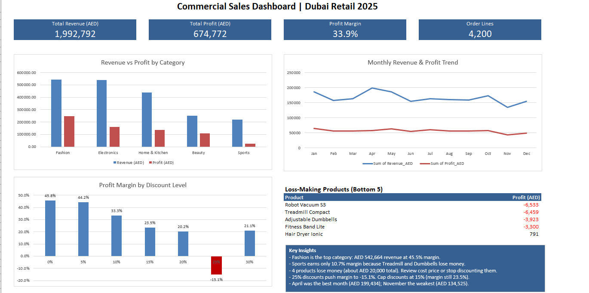

# Commercial Sales Analysis | Microsoft Excel

Sales performance analysis for a Dubai retail business (5 stores, 36 products, 5 categories, Jan–Dec 2025). Built entirely in Excel to find the top revenue categories, the loss-making products, and how discounts affect profit.

## Business Questions
1. Which product categories bring the most revenue and profit?
2. Which products are losing money?
3. How do discount levels affect profit margin?
4. How does revenue change month by month?

## Dataset
| Sheet | Rows | Description |
|---|---|---|
| Sales | 4,200 order lines | Order ID, date, store, product, quantity, unit price, discount |
| Products | 36 products | Product name, category, sub-category, unit cost |

## Excel Skills Used
- **INDEX / MATCH** to look up product name, category and unit cost from the Products sheet
- **Calculated columns** for Revenue, Cost, Profit and Month (`TEXT`)
- **SUMIFS** to build the category and store summary tables
- **Pivot Tables** with a **Calculated Field** (Margin = Profit / Revenue)
- **PivotCharts** and clustered column charts
- **Custom number formats** and a dashboard layout without merged cells

## Key Numbers
| KPI | Value |
|---|---|
| Total Revenue | AED 1,992,792 |
| Total Profit | AED 674,772 |
| Profit Margin | 33.9% |
| Order Lines | 4,200 |

### Revenue and Profit by Category
| Category | Revenue (AED) | Profit (AED) | Margin |
|---|---|---|---|
| Fashion | 542,664 | 247,054 | 45.5% |
| Electronics | 540,406 | 160,286 | 29.7% |
| Home & Kitchen | 438,429 | 137,104 | 31.3% |
| Beauty | 250,150 | 106,585 | 42.6% |
| Sports | 221,143 | 23,743 | 10.7% |

### Loss-Making Products
| Product | Profit (AED) | Margin |
|---|---|---|
| Robot Vacuum S3 | -6,533 | -10.3% |
| Treadmill Compact | -6,459 | -7.7% |
| Adjustable Dumbbells | -3,923 | -5.9% |
| Fitness Band Lite | -3,300 | -7.7% |

### Margin by Discount Level
| Discount | 0% | 5% | 10% | 15% | 20% | 25% | 30% |
|---|---|---|---|---|---|---|---|
| Margin | 45.8% | 44.2% | 33.3% | 23.5% | 20.2% | **-15.1%** | 21.1% |

## Key Insights
- **Fashion** is the strongest category: highest revenue and a 45.5% margin.
- **Sports** sells well but keeps only 10.7% as profit, because Treadmill and Dumbbells lose money.
- **4 products lose money**, about AED 20,000 in total.
- **25% discounts** push margin to -15.1%.
- **April** was the best month (AED 199,434) and **November** the weakest (AED 134,525).

## Recommendations
1. Review the cost price or selling price of the 4 loss-making products, or stop discounting them.
2. Cap discounts at 15%, where margin is still 23.5%.
3. Use Fashion and Beauty, the high-margin categories, for promotions instead of Sports.
4. Plan a November campaign to lift the weakest month.

## Files
| File | Description |
|---|---|
| `Commercial_Sales_Analysis.xlsx` | Workbook with data, formulas, pivots and dashboard |
| `Commercial_Sales_Analysis.png` | Screenshot of the final dashboard |

## Workbook Structure
`Instructions` → `Sales` → `Products` → `Summary` → `Discount Impact` → `Monthly` → `Product Profit` → `Dashboard`

---
*Note: the dataset is synthetic and was created for portfolio practice.*
